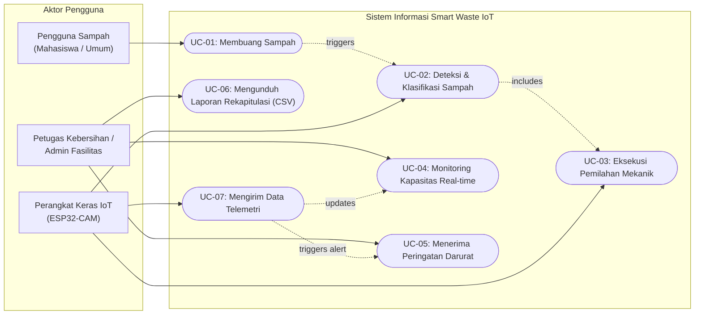
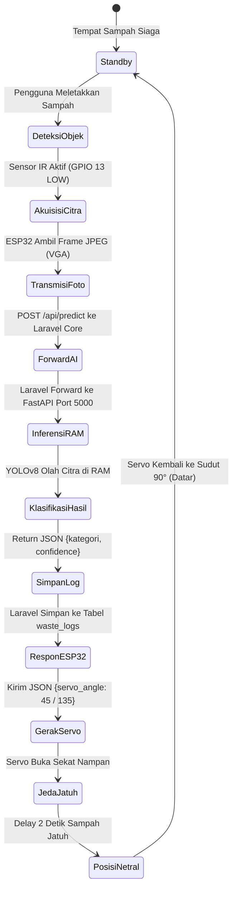
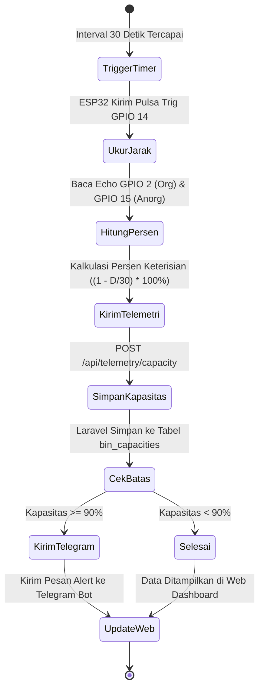
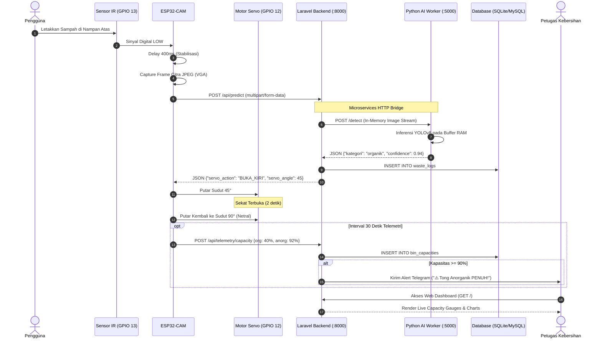
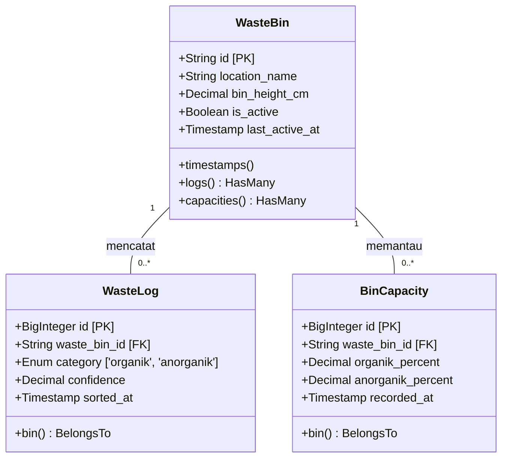

# Diagram Pemodelan UML (Unified Modeling Language)
## Format Standar Skripsi / Capstone Project Sistem Informasi

Dokumentasi diagram UML ini dirancang sesuai format baku laporan skripsi program studi **Sistem Informasi**, memodelkan fungsionalitas, alur aktivitas bisnis, dan interaksi komponen sistem secara terstruktur.

---

### 1. Use Case Diagram

Diagram Use Case memetakan interaksi antara para aktor dengan layanan yang disediakan oleh sistem informasi.

#### Deskripsi Spesifikasi Use Case:
1. **UC-01 (Membuang Sampah):** Pengguna meletakkan sampah pada nampan penampung atas tempat sampah.
2. **UC-02 (Deteksi & Klasifikasi Sampah):** Sistem secara otomatis mengambil citra dan mengidentifikasi kategori sampah (Organik/Anorganik) menggunakan model YOLOv8.
3. **UC-03 (Eksekusi Pemilahan Mekanik):** Sistem menggerakkan motor servo untuk membuang sampah ke wadah kompartemen yang sesuai.
4. **UC-04 (Monitoring Kapasitas Real-time):** Petugas kebersihan memantau persentase volume keterisian kedua tong melalui Web Dashboard.
5. **UC-05 (Menerima Peringatan Darurat):** Petugas kebersihan menerima notifikasi pesan instan via Telegram saat kapasitas tong mencapai $\ge 90\%$.
6. **UC-06 (Mengunduh Laporan Rekapitulasi):** Admin mengunduh berkas laporan pemilahan sampah berkala dalam format `.csv`.
7. **UC-07 (Mengirim Data Telemetri):** Perangkat IoT mengirimkan data ketinggian sampah secara otomatis setiap 30 detik ke server.

---

### 2. Activity Diagram: Alur Pemilahan Sampah Cerdas

Diagram aktivitas menggambarkan aliran kerja bisnis (*workflow*) mulai dari objek sampah diletakkan hingga data terekam di database.

---

### 3. Activity Diagram: Alur Telemetri Kapasitas & Notifikasi Penuh

---

### 4. Sequence Diagram: Interaksi Komponen Sistem

---

### 5. Class Diagram (Entity-Relationship Model)

